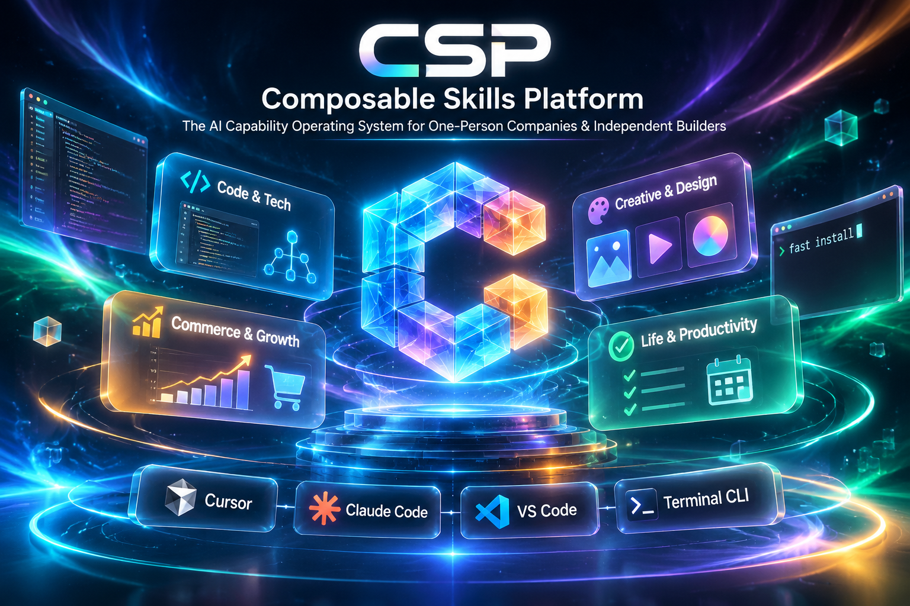
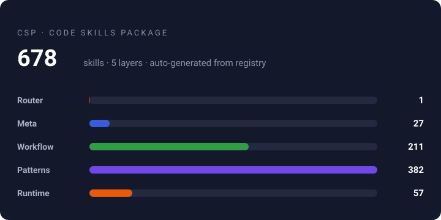
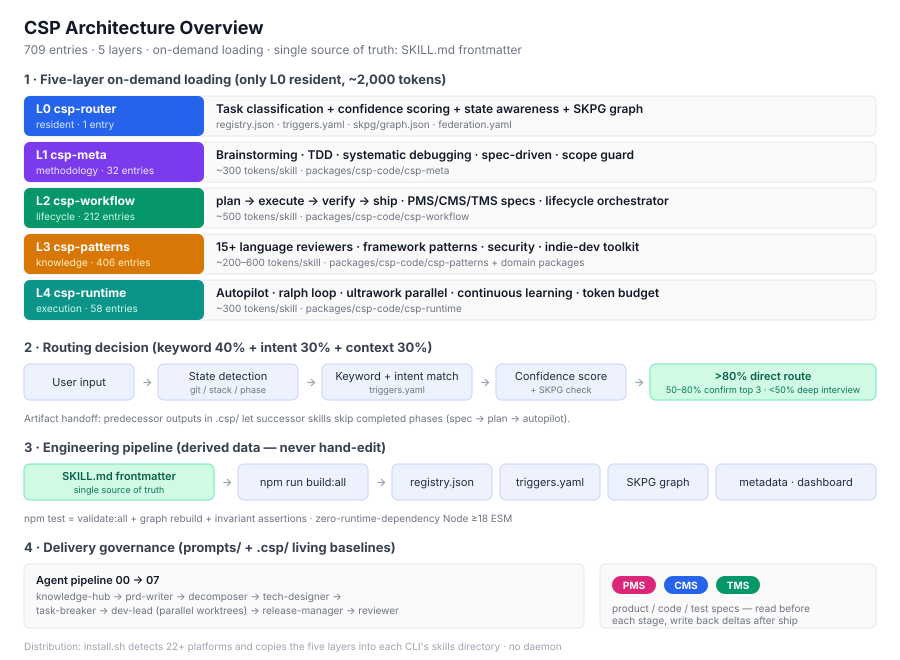

# CSP — Composable Skills Platform

<div align="center">



[](./LICENSE)
[](https://www.npmjs.com/package/code-skills-package)
[](./CHANGELOG.md)
[](./docs/reference/SKILL-INDEX.md)
[](./docs/guides/INSTALL.md)

**The AI capability operating system for one-person companies and independent builders.**

709 entries · 397 Skills + 116 Agents + 153 Commands + 36 Workflows · 22+ platforms · 15+ languages

[Quick Start](#quick-start) · [Architecture](#architecture) · [Docs](#documentation) · [中文文档](./README_zh.md)

</div>

---

CSP consolidates the essence of multiple open-source AI coding projects into a layered, on-demand skill framework. Only the L0 router stays resident (~2,000 tokens); each task loads just the minimum skill set it needs (~500–1,500 tokens). Skills hand off through artifacts in `.csp/`, automation is approval-gated, and a living three-spec layer (PMS/CMS/TMS) keeps PRD, code, and tests traceable from idea to production.

<div align="center">

<a href="https://maythyai.github.io/code-skills-package/"></a>

**🔗 [Live Interactive Dashboard](https://maythyai.github.io/code-skills-package/)** — explore all 709 registry entries by layer, category, and triggers

</div>

## Core Features

| Feature | CSP Solution |
|---------|--------------|
| **Smart Routing** | L0 decision table + confidence scoring + state awareness + SKPG knowledge graph |
| **Token Savings** | Five-layer on-demand loading + index sharding, ~500–1,500 tokens per task |
| **Skill Orchestration** | Static Recipes + autopilot phase pipeline with branching, parallel worktrees, and retry gates |
| **Gated Autonomy** | Approval gates before decomposition / tech-stack / release; QA stops after the same error repeats 3× |
| **Continuous Learning** | 5-dimensional knowledge extraction persisted to `.csp/intel/`, reused across sessions |
| **Open Extension** | Custom skills (`csp-skill-creator`) + custom workflows (`.csp/recipes.yaml`) + selective install |

## Architecture



Only the router (L0) loads at session start; L1–L4 load on demand:

| Layer | Role | Entries |
|-------|------|:-------:|
| **L0 csp-router** | Task classification + confidence scoring + state awareness + SKPG graph | 1 |
| **L1 csp-meta** | Methodology: brainstorming · TDD · debugging · spec-driven · scope guard | 32 |
| **L2 csp-workflow** | Lifecycle: plan → execute → verify → ship · PMS/CMS/TMS specs | 212 |
| **L3 csp-patterns** | Language/framework patterns · 15+ reviewers · security · indie-dev toolkit | 406 |
| **L4 csp-runtime** | Autopilot · ralph loop · parallel execution · learning · token budget | 58 |

Routing in one line: user input → state detection (Git/stack/phase) → keyword + intent matching → confidence score (keyword×0.4 + intent×0.3 + context×0.3) → **>80% direct route · 50–80% confirm top 3 · <50% deep interview**. Predecessor artifacts in `.csp/` let successor skills skip completed phases automatically.

Full design (routing pipeline, orchestration, SKPG, token strategy): [ARCHITECTURE.md](./docs/architecture/ARCHITECTURE.md) · [中文版](./docs/architecture/ARCHITECTURE_zh.md)

## Quick Start

```bash
# Auto-detect your AI tool and install (22+ platforms supported)
./install.sh

# Or target a specific platform / directory
./install.sh --platform cursor --target /path/to/your/project

# Or npm global install
npm install -g code-skills-package && cd /your/project && csp-install
```

Selective install (`--stacks`, `--layers`, `--minimal`), remote one-line install, integrity pinning (`CSP_SHA256`), and uninstall: [INSTALL.md](./docs/guides/INSTALL.md) · updates: [UPDATE.md](./docs/guides/UPDATE.md).

## Usage

Add one line to your project `CLAUDE.md` (or the platform equivalent):

```markdown
Use CSP (Composable Skills Platform) skills. When given a task, route to the appropriate skill combination via csp-router.
```

Then give tasks normally — `"Do a code review"` loads `csp-code-review` + a language reviewer; `"There's a bug in this Django project"` loads `csp-debug` + `csp-django-patterns`. Slash commands (`/csp-plan`, `/csp-debug`, `/csp-verify`, `/csp-doctor`, …) and direct invocation (`Load csp-react-reviewer …`) also work. Common scenario walkthroughs: [USER-GUIDE.md](./docs/guides/USER-GUIDE.md).

## Documentation

📖 Documentation layout: [docs/README.md](./docs/README.md) — README (front door) · `docs/` (human docs) · `.csp/` (agent artifact library).

| Document | Description |
|----------|-------------|
| [ARCHITECTURE.md](./docs/architecture/ARCHITECTURE.md) | Full architecture design (routing · orchestration · SKPG · token strategy) |
| [USER-GUIDE.md](./docs/guides/USER-GUIDE.md) | Usage guide with common scenarios and workflow chains |
| [INSTALL.md](./docs/guides/INSTALL.md) / [UPDATE.md](./docs/guides/UPDATE.md) | Installation (22+ platforms) and update guide |
| [ENGINEERING.md](./docs/guides/ENGINEERING.md) | Build pipeline, single source of truth, supply-chain safety |
| [SKILL-AUTHORING.md](./docs/guides/SKILL-AUTHORING.md) / [SKILL-SPEC.md](./docs/reference/SKILL-SPEC.md) | Skill authoring best practices and SKILL.md specification |
| [SKILL-INDEX.md](./docs/reference/SKILL-INDEX.md) | Index of all 709 registry entries |
| [VERSIONING.md](./docs/reference/VERSIONING.md) | Version policy (X=arch, Y=feature, Z=fix) |
| [FEATURES.md](./docs/reports/FEATURES.md) | Feature inventory (version × module × integration status) |
| [examples/](./examples/README.md) | Five worked examples (review, security, build-fix, simplification, dashboard) |
| [CONTRIBUTING.md](./CONTRIBUTING.md) / [CHANGELOG.md](./CHANGELOG.md) | How to contribute · release history |
| [Audit reports](./docs/reports/project-review-2026-08.md) | Multi-dimensional project reviews and case studies |

## License

[MIT License](./LICENSE) — all integrated projects use the MIT license.

## Acknowledgments

CSP integrates capabilities from: [ECC](https://github.com/burningion/video-editing-ai) (skill library) · [GSD](https://github.com/benjiwoss/get-shit-done) (lifecycle workflows) · [OMC](https://github.com/ruvcode/oh-my-claudecode) (runtime) · [Superpowers](https://github.com/SimpleVibe/Superpowers) (methodology) · [spec-kit](https://github.com/microsoft/spec-kit) (spec-driven development) · [Agency-Agents](https://github.com/msitarzewski/agency-agents) (specialized agents) · [awesome-copilot](https://github.com/github/awesome-copilot) (Copilot skills & agents).