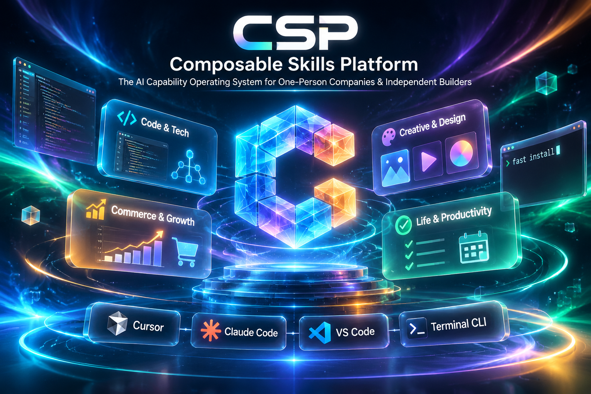
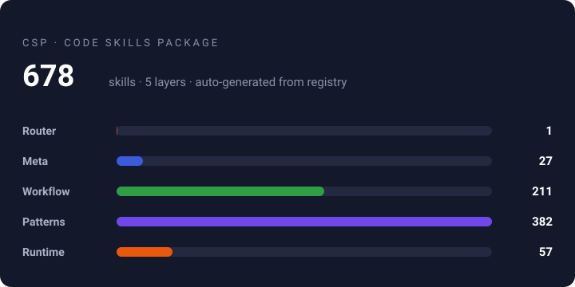
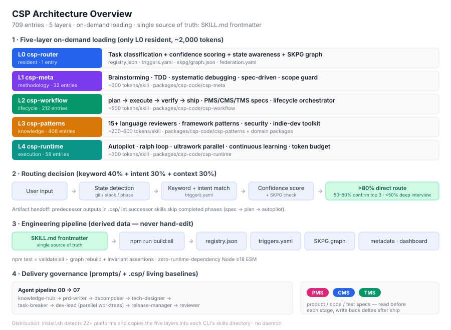

# CSP — Composable Skills Platform · 可组合技能平台

<div align="center">



[](./LICENSE)
[](https://www.npmjs.com/package/code-skills-package)
[](./CHANGELOG.md)
[](./docs/reference/SKILL-INDEX.md)
[](./docs/guides/INSTALL.md)

**面向一人公司与超级个体的 AI 技能操作系统。**

709 条目 · 397 Skills + 116 Agents + 153 Commands + 36 Workflows · 22+ 平台 · 15+ 语言

[快速开始](#快速开始) · [架构](#架构) · [文档索引](#文档索引) · [English](./README.md)

</div>

---

CSP 将多个开源 AI 编程项目的精华整合为分层按需加载的技能框架：仅 L0 路由器常驻（~2,000 tokens），每次任务只加载所需的最小 skill 集合（~500–1,500 tokens）。skill 之间通过 `.csp/` 产物自动接力，自动化带审批门控，三说明书治理层（PMS/CMS/TMS）让 PRD、代码、测试从想法到生产全程可追溯。

<div align="center">

<a href="https://maythyai.github.io/code-skills-package/"></a>

**🔗 [在线交互式仪表盘](https://maythyai.github.io/code-skills-package/)** — 按层级、分类、触发词浏览全部 709 个条目

</div>

## 核心亮点

| 亮点 | CSP 方案 |
|------|----------|
| **智能路由** | L0 决策表 + 置信度评分 + 状态感知 + SKPG 技能知识图谱 |
| **Token 节约** | 五层按需加载 + 索引分片，单任务 ~500–1,500 tokens |
| **技能编排** | 静态 Recipe + autopilot 阶段管线，支持分支、worktree 并行、门控重试 |
| **门控式自动化** | 拆解/技术栈/发布前审批门控；QA 同一错误重复 3 次即停 |
| **持续学习** | 5 维度知识提取持久化到 `.csp/intel/`，跨会话复用 |
| **开放扩展** | 自定义 skill（`csp-skill-creator`）+ 自定义工作流（`.csp/recipes.yaml`）+ 选择性安装 |

## 架构



仅路由器（L0）在会话启动时加载，L1–L4 按需加载：

| 层级 | 职责 | 条目数 |
|------|------|:------:|
| **L0 csp-router** | 任务分类 + 置信度评分 + 状态感知 + SKPG 图谱 | 1 |
| **L1 csp-meta** | 方法论：头脑风暴 · TDD · 系统化调试 · 规范驱动 · 范围控制 | 32 |
| **L2 csp-workflow** | 生命周期：plan → execute → verify → ship · PMS/CMS/TMS 三说明书 | 212 |
| **L3 csp-patterns** | 语言/框架 patterns · 15+ reviewer · 安全审查 · 独立开发者专项 | 406 |
| **L4 csp-runtime** | autopilot · ralph 循环 · 并行执行 · 持续学习 · token 预算 | 58 |

路由一句话：用户输入 → 状态检测（Git/技术栈/阶段）→ 关键词 + 意图匹配 → 置信度评分（keyword×0.4 + intent×0.3 + context×0.3）→ **>80% 直接路由 · 50–80% 确认 top 3 · <50% 深度访谈**。前置 skill 的产物落盘 `.csp/` 后，后继 skill 自动探测并跳过已完成阶段。

完整设计（路由管线、编排引擎、SKPG、Token 策略）：[ARCHITECTURE_zh.md](./docs/architecture/ARCHITECTURE_zh.md) · [English](./docs/architecture/ARCHITECTURE.md)

## 快速开始

```bash
# 自动检测 AI 工具并安装（支持 22+ 平台）
./install.sh

# 指定平台 / 目标目录
./install.sh --platform cursor --target /path/to/your/project

# npm 全局安装
npm install -g code-skills-package && cd /your/project && csp-install
```

选择性安装（`--stacks` / `--layers` / `--minimal`）、远程一行安装、完整性校验（`CSP_SHA256`）与卸载：[INSTALL_zh.md](./docs/guides/INSTALL_zh.md) · 更新：[UPDATE.md](./docs/guides/UPDATE.md)。

## 使用方式

在项目 `CLAUDE.md`（或平台等价文件）中加一行：

```markdown
使用 CSP (Composable Skills Platform) 技能包。当用户给出任务时，先通过 csp-router 路由到合适的 skill 组合。
```

之后正常下任务即可——「帮我做个 code review」加载 `csp-code-review` + 语言专项 reviewer；「这个 Django 项目有个 bug」加载 `csp-debug` + `csp-django-patterns`。也支持斜杠命令（`/csp-plan`、`/csp-debug`、`/csp-verify`、`/csp-doctor` 等）与直接调用（`加载 csp-react-reviewer …`）。常见场景演练：[USER-GUIDE.md](./docs/guides/USER-GUIDE.md)。

## 文档索引

📖 文档组织与定位见 [docs/README.md](./docs/README.md)——README（门面）· `docs/`（对外人类文档）· `.csp/`（对内 agent 产物库）。

| 文档 | 说明 |
|------|------|
| [ARCHITECTURE_zh.md](./docs/architecture/ARCHITECTURE_zh.md) | 完整架构设计（路由 · 编排 · SKPG · Token 策略） |
| [USER-GUIDE.md](./docs/guides/USER-GUIDE.md) | 使用指南：常见场景与技能链 |
| [INSTALL_zh.md](./docs/guides/INSTALL_zh.md) / [UPDATE.md](./docs/guides/UPDATE.md) | 安装指南（22+ 平台）与更新指南 |
| [ENGINEERING.md](./docs/guides/ENGINEERING.md) | 工程管线：单一真相源、构建校验、供应链安全 |
| [SKILL-AUTHORING_zh.md](./docs/guides/SKILL-AUTHORING_zh.md) / [SKILL-SPEC.md](./docs/reference/SKILL-SPEC.md) | Skill 编写最佳实践与 SKILL.md 规范 |
| [SKILL-INDEX.md](./docs/reference/SKILL-INDEX.md) | 全部 709 个条目索引 |
| [VERSIONING.md](./docs/reference/VERSIONING.md) | 版本管理规范（X=架构，Y=功能，Z=修复） |
| [FEATURES.md](./docs/reports/FEATURES.md) | 功能列表（版本 × 模块 × 集成状态） |
| [examples/](./examples/README.md) | 五个真实运行示例（审查、安全、构建修复、简化、仪表盘） |
| [CONTRIBUTING.md](./CONTRIBUTING.md) / [CHANGELOG.md](./CHANGELOG.md) | 如何贡献 · 发布历史 |
| [审查报告](./docs/reports/project-review-2026-08.md) | 多维项目审查与案例研究 |

## 许可证

[MIT License](./LICENSE) — 整合的项目均采用 MIT 许可证。

## 鸣谢

CSP 整合了以下开源项目的精华：[ECC](https://github.com/burningion/video-editing-ai)（Skill 库）· [GSD](https://github.com/benjiwoss/get-shit-done)（生命周期工作流）· [OMC](https://github.com/ruvcode/oh-my-claudecode)（运行时增强）· [Superpowers](https://github.com/SimpleVibe/Superpowers)（元技能与方法论）· [spec-kit](https://github.com/microsoft/spec-kit)（规范驱动开发）· [Agency-Agents](https://github.com/msitarzewski/agency-agents)（专业化 agents）· [awesome-copilot](https://github.com/github/awesome-copilot)（Copilot skills & agents）。