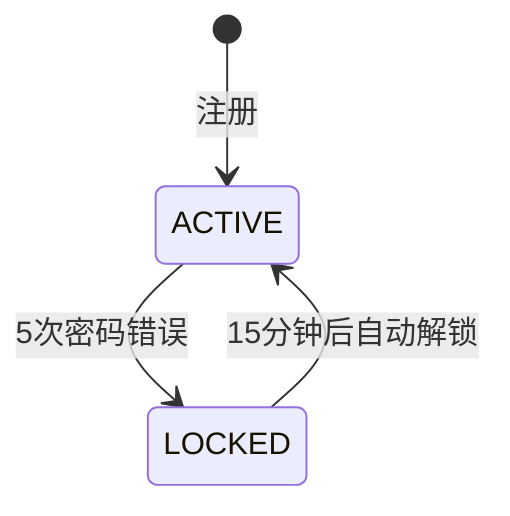
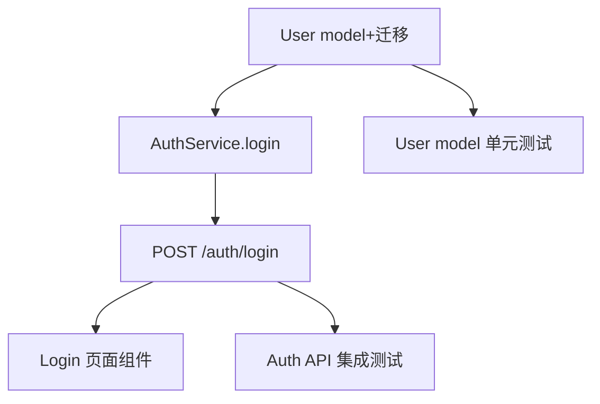

使用 CSP 产品规划能力从零到一完成产品规划全链路（调研 → 战略 → 路线图 → 审视 → 收敛 → PRD SPEC），产出可直接交棒给 [[prompts/000-develop_pipeline_csp.md]] 的版本队列。

## 规划流程

### Phase 0：项目上下文探测（强制前置）
先按 `[[workflow:csp-knowledge-hub]]` 的四层入口读取根指令→当前阶段→`.csp/AGENTS.md` 路由→本任务的 PRD/PMS；不把 manifest/历史门禁或大日志全文装入上下文。先读清现状：
1. 既有规划：`docs/strategy/STRATEGY.md` + `ROADMAP.md` 是否存在 → 决定首次/增量更新
2. 已发布版本：`git tag --list 'v*'` → 基线，规划续编
3. 07 复盘 findings：`.csp/review/REVIEW-FINDINGS-*.json`（open/deferred）→ 回流输入
4. 参考文件夹：`开源项目参考/`/`references/`/`竞品/` 等 → 若有，做竞品借鉴（Phase 0.5）

输出"规划就绪卡"：既有规划（有/无）→ 已发布版本列表 → 07 回流 finding 数 → 参考项目 → 本次定位（首次/增量）。

### Phase A：项目现状评估（非首次规划强制前置）

> 非全新项目（已有已发布版本/线上用户）**必须执行**；纯新项目（MVP 未上线）跳过。

**旧报告新鲜度检查**（防止基于过时数据做规划——你这次的 v6.59-v6.61 三个版本就是这个坑）：
- 若已有 `CURRENT-STATE-{date}.md`，先读其 `observed_at` 和 `source_commit`
- vs 当前 `HEAD`：commit 不同或距上次 >1 个 MINOR 版本 → **报告已过时，重新跑评估，不沿用旧结论**
- 上次报告数值 vs 当前实际值差异 >30% → 强制重跑，新版标"与上次评估差异"
- 旧报告保留作历史参照（标 `superseded_by`），不做本轮规划输入

**评估目的**：在规划"下一步往哪走"之前，先看清"现在在哪里"——用数据和实证而非感觉来判断产品当前状态，让每一轮规划都有事实基础。

#### A.1 产品健康度诊断

调用 `[[skill:csp-product-pulse]]`（时间窗口体验脉冲报告）+ `[[skill:csp-product-metrics-review]]`（北极星指标健康度）做产品健康度快照：

- **核心指标**：DAU/MAU、留存率（次日/7 日/30 日）、转化漏斗（各步骤转化率）、核心功能使用频次
- **异常检测**：指标突变/趋势拐点/环比异常，逐条标"信号强度"（弱/中/强）+ 可能根因假设
- **北极星子指标**：按 STRATEGY 定义的北极星指标拆解到子指标，逐子指标看健康度（healthy/watch/critical）
- 指标不可得 → 标 `[TBD-指标缺失]`，记录获取路径（需要的埋点/报表），作为后续版本的技术债输入

#### A.2 功能采用率盘点

调用 `[[skill:csp-user-analytics]]` 做逐模块/逐功能采用率分析：

- **高频功能**（采用率 >X%）：是否稳定可靠？有无进一步优化空间？
- **低频功能**（采用率 <Y%）：是入口不显眼（→ UX 问题）？是用户不需要（→ 考虑砍掉）？还是功能刚上尚未推广（→ 运营问题）？
- **死功能**（零采用率持续 N 个版本）：建议 deprecate 或砍，记入 Phase 2.5 审视候选项
- **功能使用路径**：核心任务的实际用户路径（是否与设计意图一致？有无绕路/卡住/放弃？）

#### A.3 用户痛点与反馈聚类

调用 `[[skill:csp-user-feedback-analysis]]` 做反馈聚类：

- **反馈分类**：按情感（正面/中性/负面/紧急负面）+ 主题聚类（如"登录困难""性能慢""功能缺失"）
- **痛点排序**：严重度 = 频次 × 强度 × 商业影响（高流失/高客诉/阻断核心路径），输出 Top-N
- **来自 07 复盘的回流 findings**：`.csp/review/REVIEW-FINDINGS-*.json` 中 open/deferred 项并入本阶段评估
- **支持渠道信号**：客诉工单/在线客服高频问题（如有）→ 标来源

#### A.4 体验与设计债审计

基于真实使用数据做体验问题发现（不只是"审美问题"，而是"用户用起来有问题"）：

- **关键路径摩擦**：核心任务完成时间是否增长？放弃率是否上升？中途退出点在哪？
- **违反用户习惯**（Nielsen 10 对照）：系统状态是否不可见（用户不知道在发生什么）？操作是否不符合平台惯例？是否强迫用户记忆而非识别？
- **设计混乱/不一致**：同一操作在不同模块的入口/反馈/交互是否一致？同类信息在不同页面的呈现是否统一？色调/字体/间距是否漂移？
- **功能定位错位**：是否有"设计时觉得重要、但数据证明用户不 care"的功能？是否有"用户高频使用、但入口藏在深处"的功能？
- **无障碍问题**：对比 WCAG 2.2 AA 标准，哪些页面/流程存在可达性障碍？

若已有 audit/critic/gap-analysis 的既有 findings（`.csp/audit/`、`.csp/critic/`、`.csp/gap-analysis/`），直接引用已有结论，不重复审查；只补充"当前数据视角下新暴露的体验问题"。

#### A.5 技术债与运维信号

扫描既有技术债记录 + 运维信号作为规划约束输入：

- **已知技术债**：`.csp/tech-debt/` + `csp-tech-debt-assessment` 产物（如有）→ 哪些债务正在产生"利息"（拖慢迭代/引发故障/增加维护成本）？
- **性能问题**：首屏时间/API 响应 P95/错误率/崩溃率 → 是否在恶化？
- **运维信号**：告警频率/on-call 负担/部署失败率 → 是否需要在版本中安排稳定性投入？

#### A.6 现状评估输出

产出 `docs/analysis/CURRENT-STATE-{date}.md`，包含：

```markdown
## 产品健康度快照
- 核心指标：{指标名=当前值，环比变化%}
- 北极星子指标健康度：{列表，每项 healthy/watch/critical}

## 功能采用率盘点
| 模块/功能 | 采用率 | 趋势 | 判定 | 建议 |
|-----------|--------|------|------|------|

## 用户痛点 Top-N
| 排序 | 痛点 | 严重度(频次×强度×影响) | 来源 | 对应版本建议 |

## 体验与设计债
| 问题 | 影响 | 依据 | 优先级 |

## 技术债与运维约束
- 阻碍迭代的债：{清单}
- 需安排稳定性投入的信号：{清单}

## 现状评估结论
- 本迭代必须解决的 P0 问题（安全/数据损坏/核心路径阻断）
- 本迭代应优先纳入的优化项（高频痛点/体验摩擦/设计混乱）
- 可作为长期投资主线的方向（技术债清偿/性能基线/无障碍）
```

> 现状评估的 findings **直接流入 Phase 2 版本序列规划**——痛点 → 优化主题 → 纳入版本功能行；死功能 → Phase 2.5 剔除候选项；技术债 → 版本投入预算。

### Phase R：市场调研与竞品分析
AI 自主完成全部桌面调研（多路并行搜索，证据带出处，缺口标 `[TBD]`），调用 `[[skill:csp-product-research]]`（创业方向/行业扫描/竞品深潜/经济模型）+ `[[skill:csp-competitive-analysis]]`（功能差距/差异化）：

**调研五面**：
1. **行业扫描**：赛道规模、增长率、政策环境、技术拐点
2. **竞品深潜**：本地参考文件夹 + GitHub/网络同类项目，逐项目分析功能矩阵，输出功能对照表
3. **客户洞察**：典型用户画像、核心场景、未被满足需求
4. **经济模型**：变现路径、成本结构、单位经济、商业验算
5. **方向可行性**："能不能做""有没有人在做""市场多大""机会窗口"

**产品审查视角**（调用 `[[agent:csp-product-lens-reviewer]]` 做前提挑战 + 战略后果 + 替代方案 + 目标-需求对齐审查，再按以下任务指示补充全视角审查）：

按七视角逐条审查（每条 finding = 问题 + 产品 sense rationale + 依据 + 严重度）：

**L1 定位审查**：产品核心价值主张是否清晰？首屏重点是否服务北极星？非核心功能是否喧宾夺主？与竞品的差异化是否成立、可感知？
**L2 竞品审查**：功能差距表（本产品 vs 竞品矩阵），差异化机会在哪？竞品做法哪些可取（借鉴非复制，开源协议兼容）？哪些是本产品不应跟随的？
**L3 用户审查**（辅助 `[[skill:csp-user-feedback-analysis]]`）：核心场景穿透率、用户反馈聚类、高频痛点、学习成本/路径摩擦
**L4 商业审查**：变现路径合理性、成本结构、单位经济、增长杠杆、ROI 预期
**L5 技术审查**：既有架构是否支撑规划方向？技术债是否会阻碍路线图？关键依赖是否成熟可达？
**L6 体验审查**：关键路径可用性（完成核心任务所需步骤/时间）、信息架构清晰度、状态覆盖完整性（loading/empty/error/success/disabled）、Nielsen 10 可用性启发式速查（①系统状态可见性 ②系统与现实匹配 ③用户控制权与自由度 ④一致性与标准 ⑤错误预防 ⑥识别而非回忆 ⑦灵活性与效率 ⑧美学与极简 ⑨帮助识别诊断恢复错误 ⑩帮助与文档）
**L7 演进审查**：版本序列与市场节奏是否匹配？竞品版本演进速度对比？本产品 roadmap 节奏是否可持续？

> 每条审查 finding 必带依据（file:line / 竞品截图 / 反馈原文 / 指标），推断标置信度/`[TBD]`，不臆造。

产物：`docs/analysis/MARKET-RESEARCH-{date}.md`（五面 + 七视角结论，每面独立成节）。

### Phase 0.5：竞品深度提取（有参考文件夹时触发）

> **复盘教训**：之前只从 Orca 100+ 模块中提炼了 12 条借鉴——实际可复用资产远超此数。深度提取 = 逐文件扫描 + Tier 分类 + 适配路径。

#### 0.5a: 模块扫描策略

对参考项目的每个子目录做结构化扫描：

**扫描顺序**：`src/main/`（核心业务） → `src/shared/`（共享基础设施） → `src/plugins/`（扩展点） → 配置文件

**每个模块提取 5 要素**：

| 要素 | 问什么 | 输出 |
|------|--------|------|
| 模块功能 | 这个模块解决什么问题？ | 一句话描述 |
| 输入/输出 | 它消费什么数据、产出什么？ | 接口契约摘要 |
| 核心逻辑 | 它的关键算法/状态机/规则是什么？ | 业务规则要点（Tier 判定依据） |
| 依赖关系 | 它依赖哪些其他模块？被哪些模块依赖？ | 依赖图片段 |
| 适配成本 | 直接复用 / 改写语言 / 概念借鉴？ | Tier 分类 |

#### 0.5b: Tier 分类（三级复用）

| Tier | 定义 | 判定 | 阶段操作 |
|------|------|------|---------|
| **Tier 1** | 直接适配 | 逻辑与语言无关、或目标项目同语言 | 逐文件标注适配改动点，产出 `TIER1-ADAPT.md` |
| **Tier 2** | 改写实现 | 逻辑可借鉴，但需换成目标语言（如 Java→Python） | 产出伪代码 + Python 适配方案，标注等价映射 |
| **Tier 3** | 概念借鉴 | 架构模式/设计思路/状态机设计值得参考 | 产出模式描述 + 为什么值得借鉴 + 本项目的差异 |

**Tier 1 示例**（直接适配）：
```markdown
### Orca src/shared/agent-session/journal.py → Tier 1
- 功能: Agent 会话日志——记录每轮 prompt/response/tool-use 到 journal
- 输入: messages[], session_id
- 输出: journal.jsonl (append-only)
- 适配: orca/src/shared/agent-session/journal.py → csp/src/agent/journal.py
  - 改动: 替换 import 路径（orca.utils.* → csp.utils.*），其余逻辑不变
  - 文件: 约 200 行，20 行需要改动
```

**Tier 2 示例**（改写实现）：
```markdown
### Orca src/main/bots/bot_lifecycle.py → Tier 2
- 功能: Bot 生命周期管理（init → running → paused → stopped → cleaned）
- 原语言: TypeScript
- 适配方案:
  - BotState enum → Python enum.Enum
  - BotLifecycle class → Python dataclass + async context manager
  - 状态机逻辑保持，事件系统换成 asyncio.Queue
```

**Tier 3 示例**（概念借鉴）：
```markdown
### Orca Plugin consent/approval model → Tier 3
- 模式: 用户在插件安装前看到"插件将访问 X, Y, Z 数据"，需点击"批准"
- 借鉴: CSP 的 Skill 市场在安装前展示 tool 权限清单，用户确认后安装
- 差异: CSP 不需要 OAuth 授权流，只需显示 tools: [...] 列表
```

#### 0.5c: 逐子目录深度提取清单

对参考项目的每个子目录，逐文件遍历：

```
参考项目/
├── src/main/bots/          # 逐文件分析: 哪些模式可复用?
│   ├── bot_lifecycle.ts    → Tier 2, Python dataclass
│   ├── bot_memory.ts       → Tier 1, 内存管理逻辑语言无关
│   ├── bot_chat_tree.ts    → Tier 3, 对话树架构
│   └── ...
├── src/shared/agent/       # 逐文件分析
│   ├── journal.py          → Tier 1, 直接适配
│   ├── rewind.py           → Tier 1, 直接适配
│   └── ...
└── src/plugins/            # 逐文件分析
    ├── consent.py          → Tier 3, 概念借鉴
    └── ...
```

#### 0.5d: 提取→功能映射

每条提取不只做技术标注——必须映射到本项目的具体功能（ROADMAP 版本 + Feature ID）：

```markdown
### 提取汇总表
| 来源文件 | Tier | 提取内容 | 映射到功能 | 拟纳入版本 |
|---------|------|---------|-----------|----------|
| orca: agent-session/journal.py | T1 | Agent会话日志 | F-003 会话管理 | v2.916.0 |
| orca: bots/bot_lifecycle.ts | T2 | Bot生命周期 | F-007 智能体编排 | v2.917.0 |
| orca: plugins/consent.py | T3 | 权限可见+审批 | F-011 Skill安装 | v2.921.0 |
```

**红线**：
- 借鉴非复制、标来源可追溯（`来源文件:行号`）
- 开源协议兼容（MIT/Apache 可借鉴，GPL 审慎确保不传染）
- 不被参考项目的架构"带着走"——提取的是模式，不是目录结构
- **Tier 1 项必须在 Phase 6 产出具体的文件级适配方案，Tier 2 项必须在 Phase 6 产出等价实现伪代码**——不做完就是浪费了这次深度提取

产物：`docs/analysis/COMPETITIVE-REFERENCE.md`（`来源文件 | Tier | 提取内容 | 映射到功能 | 拟纳入版本 | 适配路径`）。

### Phase 1：战略锚点
基于调研结论，调用 `[[agent:csp-pm]]`（用户故事/验收标准/优先级/RICE）+ `[[agent:csp-analyst]]`（SWOT/五力/商业模型画布/成本收益），按 Rumelt kernel 提炼 `docs/strategy/STRATEGY.md`：

1. **诊断**：产品解决什么核心问题？现状的痛点/不对称在哪？
2. **指导方针**：我们的差异化选择是什么？为什么是现在做？与竞品的核心差异是什么？
3. **为谁**：目标用户/角色/核心场景（不是"所有用户"）
4. **北极星指标**：成功怎么看 + 2-3 子指标，未定标 `[TBD]`
5. **投资主线**：3-5 条方向性主题（如"核心体验"/"平台化"/"生态"），每条一句话
6. **明确不做什么**：聚焦的代价

STRATEGY.md 短而硬——anchor，不扩成 feature list。下游 PRD 读它 ground。

### Phase 2：路线图 + 版本序列
调用 `[[workflow:csp-roadmap-planner]]` 生成长周期多版本结构化路线，产出 `docs/strategy/ROADMAP.md`。

**版本号规则（默认 SemVer X.Y.Z）**：
- **MAJOR (X)**：不兼容的 API/架构变更、移除已弃用能力——**仅在 06 发布时验证到实际 breaking 变更才 bump**
- **MINOR (Y)**：向后兼容的功能新增/主题交付，每版本通常 MINOR+1
- **PATCH (Z)**：向后兼容 bug 修复/小补丁；允许跳号
- **pre**：`alpha.N`（功能未完）/ `beta.N`（功能完）/ `rc.N`（发布候选）
- **战略主题号 ≠ SemVer 发布号**：roadmap 的"v2.0=平台化"是叙事愿景，实际 tag 从上一已发 tag 增量续编（additive→MINOR+1），只在真实 breaking 时才到达 MAJOR 战略号
- **不跳 MINOR/MAJOR**：版本号是顺序计数器，不是"宏大程度"指示器；v1.105.269 完全正常
- **默认不用日期形式**：AI 产出节奏与日历无关，按年/季/月/日定版本无意义
- **不做估时**：Agent 开发下不估人日/工时——无意义。版本顺序由依赖 DAG + 优先级 + 攒批原则决定，不按日历排期

**版本号分配前置检查**（防止跨会话碰撞）：
```bash
# 分配版本号前必须先查——最新 tag + lifecycle-state 中的已分配号
git tag --list 'v*' --sort=-v:refname | head -5   # 最新发布的版本号
grep '"version"' .csp/lifecycle-state.json         # 已分配但未发布的版本号
```
版本号分配 = `max(已发布 tag, 已分配 lifecycle 号) + 1`。禁止凭记忆或"上次大概到哪个号了"分配。

**ROADMAP 单文件真相源**：
- `docs/strategy/ROADMAP.md` 是唯一版本队列源。禁止创建 ROADMAP-ALPHA.md 等并行文件
- 审视/收敛/评审等分析产物落 `.csp/convergence/` 或 `docs/analysis/`，不回写 ROADMAP 的版本队列逻辑
- 任何 planned 版本必须有：功能清单 + PRD 路径 + 任务目录。缺任一项 → 状态降为 `stub`，不进开发管道

**攒批原则**（以模块为单位聚合）：
- 同模块功能打包到一个版本（每版本功能数以模块内实际 feature 数量为准，不设硬上限——一个模块如果有 8 个相关 feature 就全打包进一个版本），不"一个 feature 开一个版本"
- 不同模块/主题方向不同/体量过大 → 拆成下一版本
- **feat/fix 分轨**：feat 批（MINOR+1）与 fix 批（PATCH+1）不混合；同迭代既有 feat 又有 fix → 拆两个 tag

**版本序列格式**（每个版本含摘要 + 详情展开，审视通过后即为开发的完整输入）：

```
vX.Y.Z — {主题名} — status: planned

### 目标
一句话说清本版本要交付什么用户价值。

### 功能-模块-描述（功能路径）
| 功能 ID | 功能名 | 所属模块 | 功能描述 | 优先级 |
|---------|--------|---------|---------|--------|
| F-001 | 用户可登录 | MOD-AUTH-1 | 用户用邮箱+密码登录，获取 JWT token | P0 |

### 模块边界定义
- MOD-AUTH-1 职责：认证+授权+会话管理；不包含：用户资料编辑
- MOD-AUTH-1 对外能力：login() / register() / refresh() / verify()
- MOD-AUTH-1 依赖：无
- 被依赖：MOD-WORKSPACE-1（需验证登录状态）

### 细节 Specs（8 面大纲级——接口/数据/规则/错误/状态/前端交互/安全/运维，详细 Spec 归 Phase 6 的八面展开）
#### 数据实体
| 实体 | 核心字段 | 约束 | 所属 feature |
|------|---------|------|-------------|
| User | id(UUID), email, password_hash, created_at | email UNIQUE | F-001 |

#### API 端点（概念级）
| 端点 | 方法 | 请求体 | 响应 | 所属功能 |
|------|------|--------|------|---------|
| /auth/login | POST | {email, password} | {token, user} | F-001 |

### 测试维度
| 测试维度 | 覆盖目标 | 具体场景 |
|---------|---------|---------|
| 单元测试 | 认证逻辑正确性 | login() 成功/密码错/token过期 |
| 集成测试 | 登录→DB 往返 | 完整 login flow + DB 验证 |
| E2E | 用户登录完整体验 | 首页→点登录→输凭证→进工作台 |
| 安全 | 鉴权/越权 | 无 token 访问被拒绝/token 篡改被拒绝 |
| 性能 | 登录 API 响应时间 | P95 < 200ms |

### 任务路径拆解
| 任务 ID | 任务 | 涉及文件 | 前置依赖 | 预估复杂度 |
|---------|------|---------|---------|-----------|
| T-001 | 创建 User model + migration | src/models/user.py, migrations/ | — | 小 |
| T-002 | 实现 AuthService.login() | src/services/auth_service.py | T-001 | 中 |
| T-003 | 创建 POST /auth/login 端点 | src/api/auth.py | T-002 | 小 |
| T-004 | 生成 JWT + 验证中间件 | src/middleware/auth.py | T-002 | 中 |
| T-005 | 创建 Login 页面组件 | src/pages/Login.tsx | T-003 | 中 |
```

**文档规范**（嵌入治理标准）：
- 版本序列格式遵循 `[[prompts/000-project-governance_csp.md]]` G2.1 产物路径约定
- 功能 ID 格式：`F-{NNN}`，模块 ID 格式：`MOD-{DOMAIN}-{N}`，任务 ID 格式：`T-{NNN}`
- 数据实体字段遵循 `DATA-SCHEMA.md` 数据字典命名规范
- 模块边界定义必须含职责/对外能力/依赖/被依赖四要素
- 测试维度必须覆盖：单元/集成/E2E/安全/性能 五维
- 任务拆解每个任务需含涉及文件路径 + 前置依赖 + 复杂度

v1.0 = MVP：聚焦 3-5 核心功能验证问题假设；后续版本按投资主线推进。

### Phase 2.5：集成必要性审视（强制 self-critique gate）
**强制**：版本序列产出后立即审视——已规划 ≠ 必要。默认姿态是「砍」不是「留」。

调用 `[[skill:csp-integration-necessity-review]]` 做 7 维逐功能裁决（定位/场景/重叠/成本/依赖/攒批/聚焦→纳入/降级/剔除/合并）

| 维度 | 问什么 | 不通过 → |
|------|--------|----------|
| 定位契合度 | 功能是否服务 STRATEGY 锚点？ | 降级或剔除 |
| 场景必要性 | 核心用户/场景真需要？ | 剔除（无场景支撑） |
| 与现有能力重叠 | 是否已做/同批次重叠？ | 合并或剔除 |
| 集成成本 vs 价值 | 实现成本 vs 用户/业务价值？ | 降级到远期或剔除 |
| 依赖可行性 | 前置依赖是否可达？ | defer 到依赖就绪 |
| 攒批合理性 | 是否该并入同模块其他版本？ | 合并 |
| 核心场景聚焦度 | 是否落在核心业务场景？边缘场景/凑数 → | 剔除或 defer |

**裁决**（每功能四选一，必记依据可追溯）：
- `纳入`：必要，留本版本
- `降级`：移到后续版本，标 `deferred` + 解除条件
- `剔除`：移出版本序列，记入 Not working on + 原因（不静默删）
- `合并`：并入同模块另一版本

**产出**：`docs/analysis/INTEGRATION-NECESSITY-{date}.md`（审视表 `版本→功能→裁决→依据→去向`）+ 回写净版 ROADMAP + FEATURES.md。

红线：已规划不等于必要（审视可剔除已列功能），剔除/降级必须记原因，self-critique 只过滤功能层不动战略锚点，明显重叠/偏离锚点直接裁决不打断。

### Phase 3：产品架构收敛审查
调用 `[[csp-product-design-convergence]]` 做收敛审查：
- 定位对齐：功能清单是否服务同一产品定位
- 导航准入：信息架构/模块边界是否合理
- 系统卫生：技术债/冗余/死代码评估
- 迭代优先级：功能排序与依赖链路

产物：`.csp/convergence/CONVERGED-FEATURE-PLAN.md`（收敛后功能清单，下游 PRD 功能以此为唯一事实源）。

### Phase I：迭代优化与体验提升（现状评估结论并入版本规划）

> **触发**：Phase A 产出 `CURRENT-STATE` 后**强制执行**，非首次规划的每次迭代都跑。纯新项目跳过。

**目的**：将 Phase A 发现的"现有产品的可操作问题"系统性地转化为版本优化主题，确保每一轮迭代不仅有新功能，还有对既有体验的持续改进。避免"只建不修，越建越乱"。

#### I.1 优化机会提炼

从 Phase A 的评估结论中提炼三类优化机会：

**UX 体验优化**（来源：A.4 体验与设计债审计 + A.3 用户痛点）：
- 关键路径摩擦 → 简化步骤/优化信息架构/减少点击/提供默认值
- 设计混乱/不一致 → 统一组件/统一交互模式/对齐设计 Token/统一命名
- 违反用户习惯 → 按平台惯例调整/增加状态可见性/减少记忆负担
- 信息架构问题 → 重组导航/合并散落入口/提供面包屑和返回路径

**功能优化**（来源：A.2 功能采用率盘点 + A.3 痛点 Top-N）：
- 高频功能的体验打磨（不只是"能用"，要"好用"）
- 低频功能的定位调整（改进入口/改进引导/或砍掉）
- 死功能 deprecation（按入口生命周期：上线→维护→deprecation(附 TTL)→退役）

**技术优化**（来源：A.5 技术债与运维信号）：
- 阻碍迭代的债 → 安排清偿版本
- 性能恶化信号 → 设定性能基线和改善目标
- 稳定性投入 → on-call 负担降低/错误率改善

#### I.2 优化项优先级排序

按 `用户价值 × 问题严重度 × 实现成本` 三维排序：

| 优先级 | 判定 | 处置 |
|--------|------|------|
| **P0-优化** | 核心路径阻断/安全/数据正确性/大量用户受影响 | 即修——直入下一版本 PATCH 或 MINOR |
| **P1-优化** | 高频痛点/显著体验摩擦/系统性一致性违反 | 攒批进下一 MINOR 主题 |
| **P2-优化** | 体验改进/视觉统一/低频场景打磨 | 编入后续版本序列 |
| **P3-优化** | 锦上添花/极低频 | 记录备查 |

#### I.3 优化项并入版本序列

将 P0/P1 优化项**直接并入 Phase 2 的版本序列**：

- 每个版本不仅有"新增功能"行，也有"优化项"行——优化是版本主题的一部分，不是"有空再顺手做"
- 优化项与同模块的新功能打包进同一版本（攒批原则同样适用）
- 纯优化版本（无新功能）用 PATCH 号（如 `v1.4.1`）；优化+新功能用 MINOR 号
- 优化项的来源在版本行标注（`来源: Phase A-I, finding CURRENT-NN`）

产出：优化项直接回写进 `ROADMAP.md` 的对应版本功能行（标 `优化` 标签），不单独落文件。ROADMAP 版本行格式追加 `优化项: [清单，标优先级和来源]`。

### Phase 4：设计衔接（规划→设计过渡）
规划产出后，调用以下 CSP 设计技能为后续 Spec 阶段铺路：

| 阶段 | 技能 | 产出 |
|------|------|------|
| 用户体验设计 | `[[agent:csp-ux-designer]]` | 用户流/线框/可用性启发式 |
| 前端设计系统 | `[[skill:csp-frontend-design]]` | 设计语言库/Token/主题 |
| Web 多屏流程 | `[[skill:csp-flow-web]]` | 16 场景多屏 IA + 产出代码 |
| 信息架构 | `[[skill:csp-sitemap]]` | 站点地图/导航结构 |

### Phase 5：每版本规划级 PRD SPEC

> ⚠️ **Phase 5 是快速检查点，不是终点。** Phase 5 产出 planning 级大纲后，必须立即进入 Phase 6（8 面 Spec）和 Phase 7（任务拆解）。planning 级骨架的价值是快速锁定方向，不是降低深度——**10 个版本的 shallow 大纲不如 1 个版本的完整 8 面 Spec + DAG。**

调用 `[[workflow:csp-prd-generation]]`（PM 视角）或 `[[pattern:csp-prd]]`（设计师视角）为净版序列每个版本产出规划级 PRD 骨架：

- 路径：`docs/prd/PRD-{version-slug}.md`，`status: Draft`
- 结构：8 段 rapid pass——背景/目标/功能清单/用户故事一句话/优先级(P0/P1/P2)/关键业务规则要点/AC 骨架（每模块 ≥1 条 Given-When-Then 锚点）/风险与依赖。**此阶段不追求完整——快速的目的是尽快进 Phase 6 展开，不是停在这里。**
- 目的：快速校阅方向——模块边界对不对、功能归属对不对、优先级对不对。确认后立刻进 Phase 6 展开

**红线**（防滑坡——复盘发现执行者会停在大纲阶段）：
- **Planning 级骨架 ≠ 可交付。** Phase 5 做完不代表这一版"规划完成"——Phase 6（8 面 Spec）+ Phase 7（任务 DAG）必须立即跟随
- **每个 planned 版本独立满足相同的深度门控。** 做 1 个版本要 8 面 Spec，做 10 个版本也要 8 面 Spec——版本数量不是降低深度的理由
- Phase 5 产出后马上接力 Phase 6——不做"先做十个版本大纲、以后有空再展开"的滑
- 如果在 Phase 2.5 审视阶段砍了功能——被砍的越浅越好（planning 骨架就够了），留下的越深越好（必须展开到 8 面 + DAG）

产物：每版本一份 SPEC + 登记 `docs/prd/PRD-INDEX.md`。

---

### Phase G：增长与实验规划（可选，有线上用户时触发）

> 已有线上用户/指标的迭代**建议执行**；纯新项目/MVP 阶段跳过。

**目的**：基于现状评估数据，设计系统性增长实验，让产品迭代有假设-验证闭环，而不只是"我觉得该做这个功能"。

#### G.1 增长机会识别

调用 `[[skill:csp-product-metrics-review]]` 做转化漏斗分析 + `[[skill:csp-user-analytics]]` 做用户行为洞察：

- **转化漏斗各步骤流失率** → 哪一步是最大漏点？（如注册→激活 60%、激活→首日留存 40%）
- **留存拐点**：用户在哪个时间点开始流失？（Day 1/Day 7/Day 30 曲线形状诊断）
- **高价值行为**：完成哪些行为的用户留存/转化显著高于未完成用户？（→ 引导更多用户完成该行为）
- **获客渠道效率**：不同渠道的用户质量（留存/转化/LTV）是否有显著差异？

#### G.2 实验假设设计

针对增长机会，设计可验证的实验假设（每条假设 = 如果做 X → 预期指标 Y 变化 Z%）：

| 假设 | 目标指标 | 预期变化 | 验证方式 | 优先级 |
|------|---------|---------|---------|--------|
| 在注册流程增加社交登录 → 注册完成率提升 15% | 注册完成率 | +15% | A/B 测试 | P0 |
| 新用户首次登录后展示引导浮层 → Day 7 留存提升 8% | Day 7 留存 | +8% | A/B 测试 | P1 |
| 简化结账步骤从 5 步到 3 步 → 结账完成率提升 20% | 结账完成率 | +20% | A/B 测试 | P0 |

#### G.3 实验优先级与版本映射

按 ICE 评分（Impact 影响面 × Confidence 信心度 × Ease 实施容易度）排序：

- **高 ICE 实验** → 纳入近期版本（MINOR），与功能开发并行
- **中 ICE 实验** → 编入后续版本序列
- **低 ICE 实验** → 记录备查，条件成熟时再评估

实验不单独发版——与版本功能打包（如 v1.5.0 包含：新功能 X + 功能优化 Y + 增长实验 Z）。

#### G.4 实验复盘与迭代

每个实验完成后复盘：

- 假设是否成立？指标变化是否显著？是否有意料之外的副作用？
- 成立 → 固化进产品（全量上线，移除实验开关）
- 不成立 → 记录失败原因（为什么用户没按预期行为），形成"不要这么做"的知识库
- 不确定 → 调参数/换方案再试一轮

产出：`docs/analysis/GROWTH-PLAN-{date}.md`（增长机会识别 + 实验假设清单 + 优先级排序 + 版本映射）；实验完成的复盘结论回写进同文件。

---

### Phase 6：技术 Spec 生成（原 03，Layer 4）

> PRD SPEC（Phase 5）定义了 WHAT——本 Phase 产出技术级的 HOW。这是从产品到代码的最后一步翻译桥。
> **Spec 不是"后端接口文档"——是全链路的工程契约，覆盖 8 个面。**

#### 6.0 全栈 Spec 八面体系

| # | Spec 面 | 定位 | 谁消费 | 何时必写 |
|---|---------|------|--------|---------|
| 1 | **接口契约** | 每个端点长什么样 | 前端/QA/其他服务 | 任何新 API |
| 2 | **数据模型 + DDL** | 数据怎么存、字段怎么定义 | 后端/QA/DBA | 任何新 entity/字段 |
| 3 | **业务规则** | 什么条件下发生什么 | 后端/QA | 任何条件逻辑 |
| 4 | **错误场景** | 出错了用户看到什么 | 前端/QA | 任何异常路径 |
| 5 | **状态机** | 实体在什么状态间迁移 | 后端/QA/PM | 任何有生命周期的实体 |
| ~~6~~ | ~~（已移除——归入 #3 业务规则）~~ | | | |
| 6 | **前端交互** | 用户在每个屏幕状态看到什么 | 前端/QA/设计师 | 任何前端项目 |
| 7 | **安全/权限** | 谁能做什么 | 后端/前端/安全审计 | 任何有鉴权的端点 |
| 8 | **运维就绪** | 怎么部署/配置/监控/回滚 | DevOps/on-call | 任何新 feature |

#### 6.1 技术选型

调用 `[[workflow:csp-tech-stack-advisor]]` 做技术栈决策：

- 语言/框架选型（记录选型理由 + 备选方案 + 放弃原因）
- 存储层决策（PostgreSQL/MySQL/SQLite/NoSQL），产出 ADR
- 关键依赖评估（成熟度/许可/社区活跃度）

#### 6.2 技术方案设计

调用 `[[workflow:csp-tech-solution-design]]` 产出 `.csp/tech-design/`：

- 架构图（C4 或 Mermaid）：系统上下文 → 容器 → 组件
- 分层设计：路由层 → 服务层 → 数据访问层 → 数据库
- 跨模块交互：同步调用 / 异步消息 / 事件驱动
- 关键流程时序图

#### 6.3 全栈 Spec 八面生成

调用 `[[workflow:csp-fullstack-spec-generator]]` 产出 `.csp/planning/spec.md`：

---

##### 面 1-5：逻辑层 Spec（已有）

```markdown
## 1. 接口契约
| 端点 | 方法 | 请求体 | 响应体 | 状态码 | 鉴权 |
|------|------|--------|--------|--------|------|
| /auth/login | POST | {email, password} | {token, user} | 200/401 | 无 |

## 2. 数据模型 + DDL
### User
| 字段 | 类型 | 约束 | 默认值 | 说明 | 所属 feature |
|------|------|------|--------|------|-------------|
| id | UUID | PK | gen_random_uuid() | 用户唯一标识 | F-001 |

```sql
CREATE TABLE users (id UUID PRIMARY KEY DEFAULT gen_random_uuid(), ...);
```

## 3. 业务规则
- R1: 密码错误 5 次 → 账号锁定 15 分钟
- R2: 同一 IP 1 分钟内登录失败 20 次 → IP 封禁 1 小时

## 4. 错误场景
| 错误码 | HTTP | 场景 | 用户可见消息 | 是否可重试 |
|--------|------|------|------------|----------|
| AUTH_INVALID | 401 | 密码错 | "邮箱或密码不正确" | 是 |
| AUTH_LOCKED | 423 | 密码错误超限 | "账号已锁定，15 分钟后重试" | 否 |

## 5. 状态机

```

##### 面 6：前端交互 Spec（新增——前端项目必写）

> **这是复盘发现的最大 gap**：后端有完整的接口/数据/规则/错误 Spec，前端只有"做个登录页"一句话。前端开发者和 QA 需要知道每个页面在每种状态下展示什么。

```markdown
## 6. 前端交互

### 6.1 页面状态矩阵（每页面必填——不止 happy path）
| 页面/组件 | Loading | Empty | Error | Success | Disabled | Edge |
|-----------|---------|-------|-------|---------|----------|------|
| 登录页 | 按钮置灰+spinner | — | 红色提示"邮箱或密码不正确" | 跳转到工作台 | 按钮不可点（未填写邮箱/密码） | 已登录用户访问登录页→直接跳转工作台 |
| 用户列表 | 骨架屏（3行灰色占位） | "暂无用户，点击邀请成员" | "加载失败，点击重试" | 渲染表格 | 搜索栏加载中不可输入 | 列表超过 50 条→分页 |

### 6.2 用户操作路径（每核心操作一条）
| 操作 | 用户动作 | 前端行为 | API 调用 | 响应处理 | 失败处理 |
|------|---------|---------|---------|---------|---------|
| 登录 | 填写邮箱+密码，点击登录 | 按钮置灰+spinner | POST /auth/login | 存 token→跳转工作台 | 显示错误码对应消息，恢复按钮 |

### 6.3 表单校验（前端 vs 后端分工）
| 字段 | 前端校验 | 后端校验 | 前端校验失败→ | 后端校验失败→ |
|------|---------|---------|------------|------------|
| email | 非空 + 格式匹配 | 非空 + 格式 + 唯一性 | 输入框下方红字提示 | 服务器返回 422 + 错误消息 |
| password | 8-20 字符 | 非空 + 长度 + 复杂度 | 输入框下方红字提示 | 返回 401（不透露是邮箱错还是密码错） |

**规则**：前端校验防误操作（格式/长度）；后端校验是安全边界（唯一性/权限/业务规则）。前端校验通过不代表后端不校验——绕开前端的请求后端必须独立校验。
```

**为什么需要前端交互 Spec**：
- 没有它，前端开发者从"做一个页面"开始，所有状态处理靠经验猜——10 个前端做出 10 种 loading/empty/error 体验
- 没有它，QA 只能测 happy path——没有"empty 状态是什么、disabled 状态怎么触发"的规格，测试设计缺少依据
- 规格化之后，loading/empty/error/success 四个状态成为每页面的硬约束——漏一个就是 Spec 不完整

##### 面 7：安全/权限 Spec（新增——有鉴权的项目必写）

```markdown
## 7. 安全/权限

### 7.1 权限矩阵（RBAC）
| 端点 | 匿名 | 普通用户 | 管理员 | 超级管理员 |
|------|------|---------|--------|----------|
| GET /posts | ✅ | ✅ | ✅ | ✅ |
| POST /posts | ❌ | ✅ (仅自己的) | ✅ | ✅ |
| DELETE /posts/:id | ❌ | ✅ (仅自己的) | ✅ (所有) | ✅ (所有) |
| GET /admin/users | ❌ | ❌ | ✅ | ✅ |

### 7.2 鉴权方式
| 端点组 | 鉴权方式 | Token 有效期 | 刷新策略 |
|--------|---------|------------|---------|
| /auth/* | 无鉴权 | — | — |
| /api/* | Bearer JWT | 24h | POST /auth/refresh 刷新 |
| /admin/* | Bearer JWT + 角色检查 | 2h | 每次请求验证角色未变 |

### 7.3 速率限制
| 端点 | 限制 | 超出后行为 |
|------|------|----------|
| POST /auth/login | 5次/分钟/IP | 返回 429 + "请求过于频繁" |
| POST /auth/register | 3次/小时/IP | 返回 429 |
| GET /api/* | 100次/分钟/用户 | 返回 429 |
```

##### 面 8：运维就绪 Spec（新增——每个 feature 必写）

```markdown
## 8. 运维就绪

### 8.1 环境配置
| 配置项 | 环境变量 | 开发默认值 | 生产值 | 说明 |
|--------|---------|----------|--------|------|
| JWT 密钥 | JWT_SECRET | dev-secret-do-not-use | 通过 secret manager 注入 | 生产禁止硬编码 |
| Token 有效期 | JWT_EXPIRY_HOURS | 24 | 2 | 生产更短更安全 |
| 锁定阈值 | LOGIN_LOCK_THRESHOLD | 5 | 5 | — |

### 8.2 外部服务依赖
| 服务 | 用途 | 超时 | 重试 | Fallback |
|------|------|------|------|---------|
| 邮件服务 (SendGrid) | 发送验证码 | 10s | 3次 | 降级：跳过邮件，记录日志 |
| 对象存储 (S3) | 用户头像 | 5s | 0 | 返回默认头像 |

### 8.3 功能开关
| 开关 | 默认值 | 灰度策略 | 关闭后行为 |
|------|--------|---------|----------|
| FEATURE_NEW_LOGIN | false | 10%→50%→100% | 回退旧登录流程 |
| FEATURE_2FA | false | Beta 名单 | 跳过 2FA 步骤 |

### 8.4 可观测要求
| 指标 | 来源 | 告警阈值 | 告警接收 |
|------|------|---------|---------|
| 登录成功率 | POST /auth/login 2xx 比例 | < 95% 持续 5 分钟 | on-call |
| 登录 P95 延迟 | POST /auth/login 响应时间 | > 500ms | on-call |
| 锁定事件 | 账号被锁定的次数 | > 50次/小时 | 安全 team |

### 8.5 DB 迁移方案
```bash
# 正向：新增 users 表
alembic upgrade head

# 回滚：删除 users 表（仅限发布后 24h 内——之后有用户数据不可回滚）
alembic downgrade -1

# 回滚窗口：24h。超时后禁止回滚，只能 forward-fix
```
```

#### 6.4 八面 Spec 与测试的映射

| Spec 面 | 测试层 | 产出 |
|---------|--------|------|
| 接口契约 | API/集成测试 | 每个端点 1+ 条 |
| 数据模型 + DDL | DB 迁移验证 + 字段完整性 | 每个 entity 的 DDL 前向/回滚 |
| 业务规则 | 单元测试 + 集成测试 | 每条规则 normal + exception + boundary |
| 错误场景 | Negative 测试 | 每个错误码 1 条 |
| 状态机 | 状态迁移测试 | 每个合法迁移 + 每个非法迁移 |
| **前端交互** | **E2E + 组件测试** | **每页面/每状态 1 条** |
| **安全/权限** | **安全测试** | **每角色×每端点** |
| **运维就绪** | **运维验证** | **配置检查 + 迁移实跑** |

#### 6.5 设计评审

调用 `[[workflow:csp-tech-design-review]]` 审查技术方案：
- 架构合理性
- 接口设计一致性
- 数据模型完整性
- 安全风险点
- **前端状态覆盖完整性**（6 面）
- **权限矩阵无漏洞**（7 面）
- **运维就绪可执行**（8 面）

---

### Phase 7：任务拆解（原 04）

> 从 Spec 拆解为可独立开发、可验证的原子任务。**每个任务 = 一个 Agent 可独立完成的开发单元。**

#### 7.1 任务拆解

调用 `[[workflow:csp-tech-task-breakdown]]` 从 Spec 生成 `.csp/tasks/`：

**拆解规则**：
- 一个任务只能改一个模块/文件组（避免跨模块大 patch）
- 每个任务有明确的可验证产出（编译通过/测试绿/API 返回正确）
- 任务间依赖形成 DAG（无环）
- 任务粒度：小（1-3 文件，30 行以内）→ 中（3-5 文件，100 行以内）→ 大（5+ 文件，需进一步拆分）

**任务格式**：
```markdown
# T-001: 创建 User model + migration

## 前置条件
- 数据库已就绪（PostgreSQL 15+）
- Alembic 已初始化

## 涉及文件
- `src/models/user.py`（新建）
- `migrations/versions/xxxx_add_users.py`（新建）

## 实现要点
1. User model: id(UUID PK), email(unique), password_hash, created_at
2. Migration: 正向创建表，反向删除表
3. 字段命名遵循 `docs/architecture/DATA-SCHEMA.md` 数据字典

## 验收标准
- [ ] `alembic upgrade head` 创建 users 表成功
- [ ] `alembic downgrade -1` 删除 users 表成功
- [ ] `python -c "from src.models.user import User; print(User.__tablename__)"` 输出 "users"
- [ ] 字段名与 DATA-SCHEMA.md 一致

## 测试点
- Migration 正向/反向 ran+exit 0
- Model 字段类型与 DDL 一致

## 预估复杂度: 小
## 依赖任务: 无
```

**任务依赖 DAG**：


#### 7.2 实施规划

调用 `[[workflow:csp-plan-phase]]` 做实施规划：
- **Wave 排序**：按依赖 DAG 分组 → Wave 1（无依赖）→ Wave 2（依赖 Wave 1）→ Wave N
- **并行策略**：同 Wave 内无依赖冲突的任务可并行开发
- **风险标注**：高风险任务标注缓解措施

产物：`.csp/tasks/TASK-INDEX.md`（任务清单 + DAG）+ `.csp/planning/implementation-plan.md`（Wave 计划）

---

## 规划完成门控

> **每个 planned 版本独立满足以下全部条件，才允许交棒。版本数量不是降低深度的理由。**

规划阶段完成检查（全部通过才能交棒开发 Pipeline）：

- [ ] `docs/strategy/STRATEGY.md` 已产出（6 要素齐全）
- [ ] `docs/strategy/ROADMAP.md` 已产出（版本序列完整，含功能-模块-描述-边界-测试-任务）
- [ ] Phase 2.5 集成审视已完成（`INTEGRATION-NECESSITY-{date}.md` 已产出）
- [ ] Phase 3 收敛审查已完成（`CONVERGED-FEATURE-PLAN.md` 已产出）
- [ ] Phase 0.5 竞品深度提取已完成（Tier 1/2/3 分类 + 文件级适配方案）
- [ ] **每版本 PRD SPEC 已产出**（`docs/prd/PRD-{slug}.md`）— 所有 planned 版本
- [ ] **每版本 8 面技术 Spec 已产出**（`.csp/planning/spec.md`）— 所有 planned 版本，缺必写面不得标记完成
- [ ] **每版本任务拆解已产出**（`.csp/tasks/TASK-INDEX.md` 含 DAG）— 所有 planned 版本
- [ ] **Tier 1 竞品提取项已有具体文件级适配方案，Tier 2 项已有等价实现伪代码**
- [ ] 数据字典 `docs/architecture/DATA-SCHEMA.md` 已更新（新增 entity/字段）
- [ ] 产物路径遵循 `[[prompts/000-project-governance_csp.md]]` G2.1 约定

**深度一致性检查**：
```bash
# 版本数 vs 完整 Spec 数必须一致。不允许"做了 10 个版本但只有 1 个版本有完整 Spec"
planned_count=$(grep -c "status: planned" docs/strategy/ROADMAP.md)
spec_count=$(ls .csp/planning/spec-*.md 2>/dev/null | wc -l)
task_count=$(ls .csp/tasks/TASK-INDEX.md 2>/dev/null | wc -l)
echo "planned: $planned_count, specs: $spec_count, tasks: $task_count"
# spec_count ≠ planned_count → 有版本缺 Spec，未完成
```

---

## 自决策授权
调研方向、竞品取舍、版本主题与 feature 拆分、优先级排序、跨版本依赖排布、集成必要性裁决、SPEC 结构取舍、技术选型、任务拆解粒度、Wave 排序、优化项优先级、增长实验假设——你自己拍板，记入 DEV-LOG/ROADMAP，不打断我。打断条件仅 3 类：战略根本模糊 / 无法 auto-resolve 的报错 / 破坏性操作。

**缺口报告**：执行过程中若发现本说明未覆盖的维度、或引用的 CSP skill 不包含所需方法论（功能缺失/深度不足），**立即指出缺口**——不跳过、不假装覆盖、不糊过。

**默认优先**：可逆/非破坏决策自动执行，不过度问人。明显重叠/偏离锚点/依赖悬空 → 直接裁决。

---

## 交棒 pipeline
规划完成输出摘要后，交棒给 `[[prompts/000-develop_pipeline_csp.md]]`——pipeline 读取 ROADMAP 版本队列 + 任务清单，直接启动 05 实施。

```
产品规划（本文件）                         开发 Pipeline
─────────────                            ──────────────
Phase 0 上下文探测
  └→ Phase A 现状评估
      └→ Phase R 调研
          └→ Phase 1 战略锚点
              └→ Phase 2 路线图+版本序列
              │   （功能-模块-描述-边界-测试-任务 全部落实）
                  └→ Phase 2.5 集成审视
                      └→ Phase 3 收敛审查
                          └→ Phase I 迭代优化
                              └→ Phase 4 设计衔接
                                  └→ Phase 5 PRD SPEC (Layer 1+2)
                                      └→ Phase 6 技术 Spec (Layer 4)
                                          └→ Phase 7 任务拆解
                                              │                    交棒
                                              ├──────────→ 05 实施（直接开发）
                                              ├──────────→ 06 质量门控+发布
                                              └──────────→ 07 复盘
```

> **关键变化**：规划文档现在是完整的预开发中心。ROADMAP 产出时路径-功能-模块-边界-测试维度-任务拆解全部落实，Phase 6 产出可执行 Spec，Phase 7 产出带依赖 DAG 的任务清单。开发 Pipeline **不再做 01→04**，直接拿任务清单进 05 写代码。

---

## CSP Skill 路径速查

### 调研与战略

| 阶段 | CSP Skill |
|------|-----------|
| 产品研究（五面调研） | `[[skill:csp-product-research]]`（创业方向/行业扫描/竞品深潜/客户洞察/经济模型/可行性） |
| 竞品分析 | `[[skill:csp-competitive-analysis]]`（功能差距/差异化/借鉴） |
| 产品管理（PM） | `[[agent:csp-pm]]`（用户故事/验收标准/优先级/RICE 评分/用户旅程） |
| 商业分析 | `[[agent:csp-analyst]]`（SWOT/五力/商业模型画布/成本收益分析） |
| 用户反馈分析 | `[[skill:csp-user-feedback-analysis]]`（反馈聚类/高频诉求） |
| 产品指标审查 | `[[skill:csp-product-metrics-review]]`（北极星子指标短板/增长杠杆） |

### 规划与路线图

| 阶段 | CSP Skill |
|------|-----------|
| 产品透镜审查 | `[[agent:csp-product-lens-reviewer]]`（前提挑战/战略后果/目标-需求对齐，战略级审视） |
| 集成必要性审视 | `[[skill:csp-integration-necessity-review]]`（Phase 2.5 强制 gate：7 维逐功能裁决，纳入/降级/剔除/合并，默认砍） |
| Roadmap 规划 | `[[workflow:csp-roadmap-planner]]`（版本序列/战略锚点/版本号规则/SemVer 增量续编） |
| 产品架构收敛 | `[[csp-product-design-convergence]]`（定位对齐/导航准入/系统卫生/迭代优先级） |
| 需求优先级 | `[[workflow:csp-requirement-prioritization]]`（RICE/卡诺/用户故事映射） |

### PRD 与需求

| 阶段 | CSP Skill |
|------|-----------|
| PRD 生成（PM 视角） | `[[workflow:csp-prd-generation]]`（8 段结构/背景/目标/功能/AC/风险，Phase 5 规划级 SPEC） |
| PRD（设计师视角） | `[[pattern:csp-prd]]`（设计资产整合/8 段工程交底） |
| 产品能力翻译 | `[[skill:csp-product-capability]]`（PRD→SRS，约束/不变量/接口） |

### 技术 Spec 与任务拆解（Phase 6 + Phase 7）

| 阶段 | CSP Skill |
|------|-----------|
| 技术选型 | `[[workflow:csp-tech-stack-advisor]]`（语言/框架/存储/依赖评估，ADR 产出） |
| 技术方案设计 | `[[workflow:csp-tech-solution-design]]`（架构/分层/跨模块交互/时序图） |
| 全栈 Spec 生成 | `[[workflow:csp-fullstack-spec-generator]]`（接口契约/数据模型/DDL/错误场景/状态机） |
| 设计评审 | `[[workflow:csp-tech-design-review]]`（架构/接口/数据/安全审查） |
| 任务拆解 | `[[workflow:csp-tech-task-breakdown]]`（DAG/原子任务/验收标准/测试点） |
| 实施规划 | `[[workflow:csp-plan-phase]]`（Wave 排序/并行策略/风险标注） |

| 阶段 | CSP Skill |
|------|-----------|
| 用户体验设计 | `[[agent:csp-ux-designer]]`（用户流/线框/可用性启发式） |
| 前端设计系统 | `[[skill:csp-frontend-design]]`（设计语言库/Token/主题/16 风格矩阵） |
| Web 多屏流程 | `[[skill:csp-flow-web]]`（16 场景/Spark-Ant-shadcn 三路径/IA 骨架） |
| 信息架构 | `[[skill:csp-sitemap]]`（站点地图/导航结构/页面层级） |

### 现状评估与持续优化（Phase A + Phase I）

| 阶段 | CSP Skill |
|------|-----------|
| 产品体验脉冲 | `[[skill:csp-product-pulse]]`（时间窗口体验脉冲报告，Phase A 产品健康度快照） |
| 用户行为分析 | `[[skill:csp-user-analytics]]`（功能采用率/用户路径/转化漏斗，Phase A 功能盘点 + Phase G 增长识别） |
| 用户反馈分析 | `[[skill:csp-user-feedback-analysis]]`（反馈聚类/痛点排序，Phase A 痛点识别） |
| 产品指标审查 | `[[skill:csp-product-metrics-review]]`（北极星拆解/健康度/异常检测，Phase A 诊断 + Phase G 漏斗分析） |
| 数据分析 | `[[skill:csp-data-analysis]]`（Python 分析/可视化，辅助指标深挖） |

### 增长与实验（Phase G）

| 阶段 | CSP Skill |
|------|-----------|
| 增长实验设计 | Phase G 任务指示（ICE 评分/假设-验证闭环/A/B 实验设计） + `[[skill:csp-user-analytics]]`（行为洞察） |
| 产品指标审查 | `[[skill:csp-product-metrics-review]]`（转化漏斗/留存拐点/高价值行为识别） |

---

## 产物路径

```
项目根/
├── docs/strategy/
│   ├── STRATEGY.md                  # 战略锚点（诊断/方针/为谁/指标/主线/不做）
│   └── ROADMAP.md                   # 版本号规则 + 净版版本序列（审视后）
├── docs/FEATURES.md                 # 功能列表（版本×模块×功能×状态）
├── docs/prd/
│   ├── PRD-{version-slug}.md         # 每版本规划级 PRD SPEC
│   └── PRD-INDEX.md                  # PRD 索引
├── docs/analysis/
│   ├── CURRENT-STATE-{date}.md        # 项目现状评估（产品健康度/功能采用率/痛点/体验债/技术债）
│   ├── MARKET-RESEARCH-{date}.md     # 市场调研（五面+七视角）
│   ├── COMPETITIVE-REFERENCE.md      # 竞品借鉴清单
│   ├── INTEGRATION-NECESSITY-{date}.md # 集成必要性审视表
│   └── GROWTH-PLAN-{date}.md         # 增长实验规划（假设清单+ICE 排序+版本映射+复盘结论）
├── .csp/
│   ├── convergence/
│   │   └── CONVERGED-FEATURE-PLAN.md     # 收敛后功能清单
│   ├── planning/
│   │   ├── spec.md                        # Phase 6 全栈 Spec
│   │   └── implementation-plan.md         # Phase 7 实施计划
│   ├── tech-design/                       # Phase 6 技术方案
│   ├── tasks/                             # Phase 7 任务拆解
│   │   ├── TASK-INDEX.md                  #   任务清单 + DAG
│   │   └── T-{NNN}-{slug}.md              #   逐任务详情
│   └── manifest.json                      # 产物回写索引
```

---

## 反模式速查

| 反模式 | 症状 | 正确做法 |
|---|---|---|
| 规划=feature list | 列功能无战略锚点 | Anchor not plan；战略是 what/why |
| 战略主题号当 SemVer 打 tag | 起步标 v2.0.0（MAJOR）但无 breaking | 战略号≠SemVer；additive→MINOR 增量 |
| 规划完不审视 | 已规划即保留，堆功能不过滤 | Phase 2.5 强制 7 维 self-critique，默认砍 |
| 审视静默删 | 剔除/降级不留原因 | 剔除必记依据，可追溯 |
| 功能发散堆砌 | 为"完整感"堆边缘场景 | 精简聚焦核心业务场景 |
| 跳过调研拍脑袋 | 版本主题无事实输入 | Phase R 先调研，锚点基于结论 |
| 规划止步 ROADMAP | 有版本表无 PRD SPEC | Phase 5→6→7 每个 planned 版本强制产出完整 8 面 Spec + DAG |
| 竞品浅扫 | 只看 README/features，不逐文件扫描 | Phase 0.5 逐子目录遍历 + Tier 分类 + 文件级适配方案 |
| 版本越多深度越薄 | 做了 10 个版本但只有 1 个有完整 Spec | 每个版本独立满足深度门控——做 1 个要全深度，做 10 个也要全深度 |
| Planning 骨架当终点 | Phase 5 产出大纲就标记"规划完成" | Phase 5 是检查点不是终点——Phase 6+7 必须立即跟随 |
| 臆造指标 | 编 DAU/收入目标 | 未定标 `[TBD]`，留给 01 确认 |
| 规划=排期 | Gantt 化堆日期/估人日/设截止 | Agent 开发下估时无意义（人 3 天的活 Agent 几分钟完成），路线图示方向不示日期；版本号 SemVer 增量续编，版本序列按依赖+优先级排序 |
| 过度问人 | 每节反复确认 | 默认优先，仅战略模糊时人工澄清 |
| 只建不修 | 只规划新功能，不优化既有体验 | Phase A+I 强制：每轮迭代必审现状，优化项与功能同权纳入版本 |
| 数据盲飞 | 无指标依据靠感觉排优先级 | Phase A 先做健康度快照 + 痛点排序，用数据驱动"该做什么" |
| 用旧报告做规划 | CURRENT-STATE 来自上个版本但直接当本轮输入 | Phase A 强制新鲜度检查：commit 不同/超 1 个 MINOR → 重跑评估 |
| 增长靠猜 | 做功能但不知道是否有效 | Phase G 实验假设-验证闭环，每个增长动作可衡量 |

---

按现状评估 → 调研 → 战略 → 路线图 → 审视 → 收敛 → 迭代优化 → 设计衔接 → PRD SPEC → 增长实验十步链执行，AI 自主完成，不打断我。

**非全新项目（已有线上用户/已发布版本）**：Phase A（现状评估）必跑 → Phase I（迭代优化）必跑 → Phase G（增长实验）建议跑。优化项与新增功能同权纳入版本序列，不"只建不修"。

**纯新项目（MVP 未上线）**：跳过 Phase A/I/G，从 Phase R 调研开始。

每个阶段按进度条播报，全部完成后输出总摘要，交棒 pipeline 启动交付。

---

## 三文档协作与四层深度分工（固定契约）

本文件是 CSP 三件套之首（规划段），承担所有预开发工作。四层深度分工在此**一次定死**：

| 层 | 产物 | 归属 | 深度边界 |
|----|------|------|---------|
| Layer 1 | `docs/strategy/ROADMAP.md` | **本文件** Phase 2 | 功能-模块-描述-边界-测试维度-任务路径拆解，全部落实 |
| Layer 2→4 | PRD + 8 面 Spec + 任务 DAG | **本文件** Phase 5→6→7 | 一次性完成：rapid pass 确认方向 → 8 面展开（接口/数据/DDL/规则/错误/状态/前端交互/安全/运维）→ 任务 DAG。**缺任一层不得标记版本完成。** |

**任务拆解**（Phase 7）为 Spec 的自然产出——Spec 中每个功能已标注涉及文件和复杂度，任务拆解是形式化。

**分工红线（v2）**：全部在规划阶段完成。开发 Pipeline 直接消费 ROADMAP + Spec + 任务 DAG。
**上下文完备性**：交棒时所有机器可独立执行——不依赖规划机器的内存。8 面 Spec + 任务 DAG 就是开发的完整上下文。

> **反例**：在机器 A 做了 10 个版本的 planning 大纲，只展开 1 个版本的 8 面 Spec。机器 B 拿到交棒包后，9 个版本无法开发——Spec 缺失、任务 DAG 缺失、上下文缺失。**每个版本独立满足门控，不因版本数量降低深度。**

```
000-product-planning_csp.md（本文件）
  │  产出: ROADMAP (Layer 1+详情: 功能/模块/边界/测试/任务)
  │       + PRD SPECs (Layer 2+3, planning→engineering)
  │       + 技术 Spec (Layer 4) + 任务拆解 (Phase 7)
  │  门控: Phase 2.5 集成审视 + Phase 3 收敛审查 + 规划完成门控
  │
  ├──→ 交棒 000-develop_pipeline_csp.md
  │      Pipeline 读任务清单 → 直接进 05 实施
  │      （不再做 01 PRD升级/02 拆解/03 Spec/04 任务——这些已在规划完成）
  │
  └──→ 输入 000-test_pipeline_csp.md
         测试 Pipeline: Spec (Layer 4) + 任务清单 → TB→TD→分层实施→门控
         测试维度在 ROADMAP 阶段已定义，Spec 阶段产出可测试性点
```

**与项目治理的关系**：
- 产物路径遵循 `[[prompts/000-project-governance_csp.md]]` G2.1 约定
- 数据模型字段命名遵循 `DATA-SCHEMA.md` 数据字典
- 文档 frontmatter 遵循 GK.4 约定
- 版本号遵循 G1.1 SemVer 规则

---

要给到 planning→engineering, Spec 和 任务拆解等深度文档。
